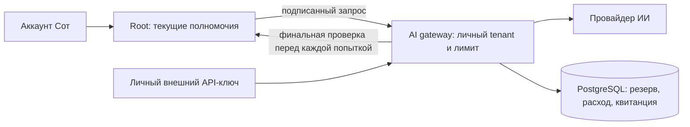

# Личный ИИ аккаунта Сот

Шлюз входит в исходники и выпуск Сот как `services/ai-gateway`. Отдельные контейнер и PostgreSQL сохраняют границу между идентификацией человека, приложениями и учётом запросов.



Новый и существующий аккаунт получают профиль ИИ автоматически. Фоновое восстановление и первая фактическая попытка закрывают временную недоступность шлюза; регистрация и главное поле не ждут сетевого provisioning. Второе устройство, переименование профиля и восстановление входа сохраняют тот же аккаунт. Внутренний ключ существует без экспортируемого bearer: обычному человеку не нужно его создавать, копировать или вставлять.

Внешние ключи для программ — отдельная возможность владельца в «Меню → Профиль и настройки → ИИ и API». Секрет выдаётся один раз. Повтор операции с тем же идентификатором возвращает метаданные без нового ключа и повторного раскрытия секрета. При переключении аккаунта и закрытии панели секрет удаляется из интерфейса и памяти. Устаревшее редактирование защищено ревизией политики.

## Идентификация и ограничения

Стабильная пара — установленный issuer `https://4-2.xn--p1ai` и проверенный `accountId`. Имя, cookie временного кабинета, Host и присланный человеком tenant не выбирают плательщика. Направления Root → gateway и gateway → Root используют разные Ed25519 ключи, закреплённые публичные ключи, короткий срок доказательства и одноразовые nonce. Подпись связана с точными методом, маршрутом и байтами тела.

Перед каждой отправкой провайдеру, включая повторный маршрут и выход из очереди, шлюз проверяет политику и запрашивает Root о первоначально захваченных полномочиях. Отмена и отзыв устройства запрещают отложенную отправку. Уже принятую провайдером работу нельзя отменить задним числом: реальный расход учитывается, неизвестный исход остаётся в резерве до подтверждения.

Личные и внешние ключи одного человека используют общий учёт и атомарные ограничения. Новое устройство, новый ключ или ротация не обнуляют расход. По умолчанию включено 50 ₽ сервисного лимита один раз на аккаунт, до 5 ₽ в день и 1 ₽ на запрос; общий существующий бюджет оператора также ограничивает работу. Это включённая услуга, без денежных пополнений, выплат или долга пользователя. Начисление сохраняется в отдельной сбалансированной записи; повторный provisioning не повторяет его. Изменение файла начальной политики не пополняет уже существующие аккаунты.

В production-профиле от 25.10.2026 предел запроса составляет 5 ₽, а выходного ответа — 32768 токенов: это обеспечивает совместимость штатного клиента MiniMax. Root допускает 32k только для канонического MiniMax в account bridge режиме; GLM и DeepSeek сохраняют 8192. Однократные 50 ₽, дневные 5 ₽ аккаунта и прежний общий бюджет сервиса 50 ₽/сутки сохранены. Внешний ключ без собственного сужения наследует политику аккаунта. Актуальную установленную конфигурацию проверяет [защищённый оператор шлюза](../services/ai-gateway/deploy/PRODUCTION.md).

Встроенный помощник сохраняет точную модель GLM и прежние границы источников, инструментов и действий. Задача локального коннектора использует подтверждённого владельца задания. Статическое приложение использует явно установленного служебного спонсора `svc_…`, отдельного от личных аккаунтов. Дополнительная совместимость со старым коннектором требует закрепления конкретного credential и отсутствия личного владения; неуспешный личный запрос не переводится на служебный бюджет.

## Исходники и проверки

Основные точки: `server/account-ai.js`, `server/account-ai-configuration.js`, `server/personal-agent-transport.js`, `modules/connect/server/index.mjs`, `src/world/ai-settings.ts`, `services/ai-gateway/apps/gateway` и `services/ai-gateway/packages/soty-bridge`.

Нужен Node 24.19 или совместимый более новый. Зависимости Root устанавливаются его штатным pnpm lock; зависимости шлюза — `npm ci --ignore-scripts` в `services/ai-gateway`. Синтетические SQL проверки принимают только отдельную БД с именем, оканчивающимся на `_test`, через `TEST_DATABASE_URL`. Они создают собственную schema и удаляют только её.

```text
node --test server/test/account-ai*.test.mjs modules/connect/test/account-provisioning-host.test.mjs
node --test deploy/connector/universal-account-ai.test.mjs
node --test scripts/account-ai/full-stack.test.mjs
```

В шлюзе `npm test` проверяет финансовую изоляцию, идемпотентность, конкуренцию, неизвестный расход, ротацию/отзыв, финальную авторизацию и реальные HTTP потоки с синтетическим провайдером. Сквозной тест отдельно соединяет настоящий Root, настоящий gateway и PostgreSQL: обычный запрос помощнику, второе устройство, внешний ключ, служебные JSON/SSE и холодный перезапуск.

## Выпуск и восстановление

Root читает server-only файл `SOTY_ACCOUNT_AI_CONFIG_FILE` со schema `soty.account-ai-installed.v1`; gateway — `SOTY_BRIDGE_CONFIG_FILE` со schema `soty.ai-gateway-bridge.v1`. Ключи провайдеров и подписи не передаются в браузер, localStorage, приложение или установщик. Пример конфигурации шлюза и служебный протокол находятся в [документации модуля](../services/ai-gateway/docs/SOTY-ACCOUNT-AI.md).

Новый файл Root добавляется через `accountAi: {source}` в существующем защищённом плане выпуска. Проверка связывает точные приватные байты и файл с зашифрованным witness, требует capability нового образа и разрешает только ожидаемую смену AI транспорта. Изменение набора моделей, путей, данных или чужих настроек остаётся отдельной проверкой. В окне обслуживания новые AI запросы и изменения ключей не принимаются; уже оплаченный ответ и квитанция сохраняют своё право на завершение.

`prepare` и `promote` выполняются в одной стабильной файловой среде оператора. При запуске CLI через Docker нужен один контейнер на обе фазы с отдельными `docker exec`: witness закрепляет также inode цепочки каталогов, включая корень. Новый одноразовый `docker run --rm` на каждую фазу закономерно отклоняется. До остановки сервера отдельно проверьте восстановление witness из нового процесса того же оператора; проверку идентичности файлов не ослабляйте. После подтверждённой остановки исходного сервера обязательный `afterJournal(original_stopped)` создаёт зашифрованный backup до первого запуска кандидата.

Публичный UI выпускается отдельно с привязкой к точному образу и единственному работающему Root writer. При обновлении шаблона publisher заново закрепите как disk SHA Caddy, так и SHA фактического autosave после проверки их семантического равенства. Хеш активной конфигурации прежнего выпуска нельзя переносить в новый план. Сохраняйте принятые обложки, skills, прежние immutable URL и квалификацию установщиков; после публикации проверяйте публичные байты и штатное обновление PWA с черновиком.

До выпуска нужны полные сборки обоих образов, синтетический сквозной тест, холодная проверка изолированной копии текущих данных и проверенное восстановление зашифрованной копии. Резервные копии конфигурации и данных содержат секреты и хранятся только зашифрованными. Старый общий ledger сохраняется как общая история, без выдуманного распределения между людьми.

После принятия новых личных запросов старый gateway нельзя возвращать в обслуживание Soty ключей: он не знает новых общих лимитов и резервов неизвестного расхода. Сохраняйте новый gateway и текущую БД. Временный откат Root требует совместимого личного AI транспорта либо отключения старого общего AI транспорта, включая старую личную конфигурацию и прямые provider credentials. Откат кода не восстанавливает старый снимок поверх новых данных.
